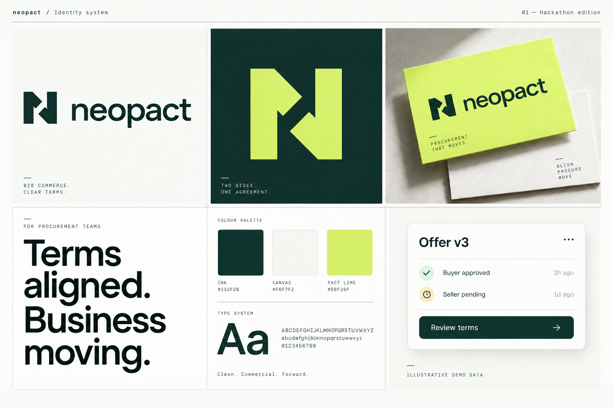

# neopact · Brand system

Version 1.0 · Hackathon working identity · 10 October 2026

A portable brand and interface kit for the neopact B2B marketplace. Share the complete folder with the hackathon team so designers and implementation agents use the same identity, tokens, assets, and product vocabulary.

**Terms aligned. Business moving.**

## Start here

- Open [`visual-guide.html`](visual-guide.html) for the visual guide and interface examples.
- View [`brand-board.png`](brand-board.png) for a shareable overview.
- Give implementation agents [`AGENT-HANDOFF.md`](AGENT-HANDOFF.md), including its copy-paste task prompt and precedence rules.
- Read [`PALETTE-RESEARCH.md`](PALETTE-RESEARCH.md) for the color evidence, measured contrast, and conversion-testing plan.
- Read [`BRAND-GUIDE.md`](BRAND-GUIDE.md) for logo, voice, typography, and brand use.
- Use [`COMPONENTS.md`](COMPONENTS.md) for component rules and [`tokens/README.md`](tokens/README.md) for token integration.
- Download/share the complete archive: [`../neopact-brand-system.zip`](../neopact-brand-system.zip).

Keep the folder structure intact when sharing or opening the HTML guide; its local asset paths rely on that structure.

## Package map

| Path | Contents |
|---|---|
| `visual-guide.html` | Visual reference and sample product surfaces |
| `brand-board.png` | Raster overview for quick sharing |
| `AGENT-HANDOFF.md` | Copy-paste agent brief, invariants, scope, acceptance checks |
| `BRAND-GUIDE.md` | Identity, logo use, color, type, voice, provenance |
| `COMPONENTS.md` | Reusable interface specifications |
| `tokens/tokens.css` | CSS custom properties, typography, and global foundations |
| `tokens/tokens.json` | Machine-readable token reference |
| `tokens/components.css` | Reusable component styling |
| `tokens/README.md` | Token installation and integration notes |
| `assets/logos/` | Canonical outlined SVG logos, app icon, favicons |
| `assets/logos/png/` | Matching raster logo exports |
| `assets/fonts/` | Local Manrope Variable and IBM Plex Mono Regular fonts, OFL licenses, and source notes |

## Which logo to use

Start with `assets/logos/neopact-logo-primary.svg` on a light surface or `assets/logos/neopact-logo-reversed.svg` on a dark surface. Use the standalone mark when space is limited. PNG exports serve documents and slide tools that cannot import SVG.

Do not recreate the wordmark with live text. Keep at least one quarter of the visible mark height as clear space. Full lockup minimum: 140px wide. Standalone mark minimum: 24px; favicon exception: 16px. See `BRAND-GUIDE.md` for every variant.

## Implementation fit

The current frontend uses Next.js, React, TypeScript, Lucide icons, and native CSS. Import the supplied tokens and bundle the local fonts without changing that stack. Use the canonical assets and component rules; avoid adding another palette or spacing system.

Examples illustrate design behavior. They do not add backend capability. In particular, preserve private limits, workspace permissions, exact offer versions, separate party approvals, and the distinction between a confirmed demo order and payment or delivery. Current and target flows are documented in `AGENT-HANDOFF.md`.

## Release context

The name **neopact** is user-confirmed; this version 1 visual direction is assistant-proposed for the hackathon. Name and mark availability have not been assessed. The provenance and current repository context are recorded in `BRAND-GUIDE.md`.
